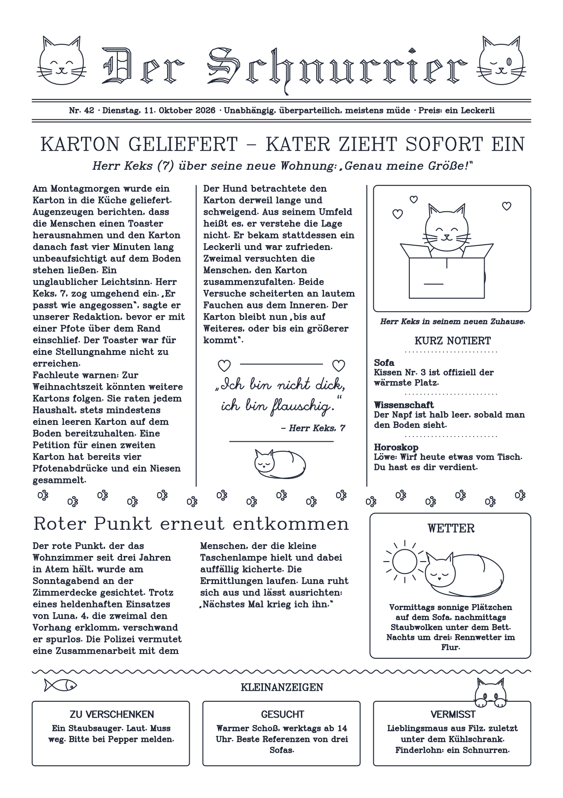

# Stiftwerk

A cozy browser app for GRBL pen plotters (GRBL 1.1, FluidNC, grblHAL; reference device: UUNA TEK iDraw 2.0 A4).
It talks to the plotter directly via **Web Serial** – no installation, no Inkscape. The interface is available in
English and German.

## Try it
- **App:** https://leggin.github.io/stiftwerk/ – connect your plotter via USB (Chrome, Edge or Firefox with Web Serial).
- **Demo:** https://leggin.github.io/stiftwerk/demo.html – the same app with a simulated plotter, no hardware needed.

## Features
- **Design:** open SVGs (including `<use>`, clip paths and hidden-line removal), convert each text to a plotter font
  (Hershey or your own SVG fonts), rotate freely, mirror, align, snap, make copies with cut marks, and add patterns
  and templates (borders, grids, spirals, rosettes, calendars, name cards).
- **Pens:** one pen for everything, or spread the colors over several pens; a pen library with its own speed,
  pen-down depth and line width per pen.
- **Plotting:** pre-flight check, frame trace, a live view of the line being drawn, a calm remaining-time estimate,
  pause, and continuing from any line (also after a lost connection), plus G-code export.
- **Plotter profiles** for different machines and sheet sizes (Z axis, servo or custom G-code pen).
- **Documents:** saved automatically in the browser; project files (`.stiftwerk.json`) with embedded fonts.

## Getting started
- Build: `python3 build.py`, then open `dist/stiftwerk.html` in Chrome, Edge or Firefox (with Web Serial).
- Try it without a plotter: `python3 build.py --dev` also writes `dist/stiftwerk.dev.html` with a simulated plotter.
- Tests: `npm test` (Node, no dependencies).

## Plottable art from scripts
`tools/plotart/` is a small Python library (standard library only) for designing plottable SVGs – vouchers, cards,
a cat newspaper, generative patterns – including checks (text collisions, pens, plot time) and previews.
Example: `art/katzenzeitung/` ("Der Schnurrier"). Details in `tools/plotart/README.md`.

## More
- Architecture, plotter protocol and design decisions: `docs/entwicklung.md` (German).
- Rules for changing the code: `docs/contract.md`.

## License
Copyright © 2026 Nicolas Hilberg. Free software under the **GNU General Public License v3** (or any later version) –
see [LICENSE](LICENSE).
